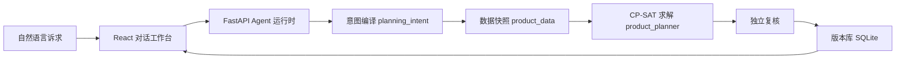

# 「一修」—— 海上风电检修排程 Agent

> 用一句话排检修：中文描述目标与约束 → 可审计的整数规划 → 真实求解 → 独立复核 → 方案入库。

**一修**是面向海上风电场的对话式检修排程决策系统。计划员用自然语言说出「优先修高风险」「船租上涨 20%」「每天最多 2 条作业线」这类诉求，系统把它编译成**固定的 CP-SAT 整数规划模型**，用 OR-Tools 真实求解，再由独立的费用与排程计算器复核，每一步都留下模型指纹与审计证据。

核心原则只有一条：**大模型负责「翻译」，求解器负责「计算」**——不让 LLM 凭概率生成数字，所有数字只能来自求解器与只读工具。

## 核心能力

**① 自然语言 → 可验证的数学模型**
三层解析（规则直出 / 向量检索 / LLM 生成），产物必过确定性校验器，杜绝幻觉。122 项建模参数、8 类部件、100 台风机、4 个优化策略、7 个可加权指标全部登记在册，LLM 只能引用、不能编造。

**② 可复现的决策，可回查的证据**
每次求解生成模型指纹、决策契约与原始 `solver_model.pbtxt`，同一份契约同一时限必得同一结论。方案可回看数学模型、参数来源、成本构成与审计证据。

**③ 求解状态诚实**
严格区分 `OPTIMAL / FEASIBLE / UNKNOWN / INFEASIBLE` 四种状态，**不把「超时」说成「无解」**；启发式兜底会明确标注「未证明最优」。

**④ 会话记忆：多轮不遗忘**
结构化记忆快照（状态 / 约束 / 产物 / 动作 / 问答）+ 滚动摘要，长对话不再丢早期背景。

**⑤ 并发求解互不覆盖**
多个求解任务并行运行、各自独立入库，新方案不会挤掉仍在后台跑的任务。

**⑥ 多方案对比**
「对比方案 01 和 02」由确定性工具算出三层差异：事实与差值、差异归因、下钻索引。

## 系统架构



一条链路：**自然语言 → 固定模型契约 → 真实求解 → 独立复核 → 版本入库**。

## 难点与解法

| 难点 | 解法 |
| --- | --- |
| 大模型会把自然语言「算」出幻觉数字 | 只让 LLM 做结构化翻译，产物过确定性校验器，数字只能来自求解器与工具 |
| 长多轮对话丢失早期约束与方案 | 结构化会话记忆快照 + 滚动摘要 + 有界上下文组装 |
| 求解超时被误报成「无解」 | 四态严格区分，启发式兜底明确标注「未证明最优」 |
| 新求解覆盖后台运行的旧任务 | 求解器按输出目录并发加锁，前端多任务跟踪 |
| 多方案说不清差在哪 | 确定性三层对比，数字与差值全部来自工具 |

## 技术栈

| 层 | 技术 |
| --- | --- |
| 前端 | React · TypeScript · Vite · shadcn/ui |
| 后端 | Python 3.12 · FastAPI · SQLite |
| 求解器 | OR-Tools CP-SAT（有界整数调度） |
| 对话模型 | DeepSeek（Anthropic 兼容接口），未配置时回退确定性规则解析 |

## 快速开始

要求 Python 3.12（求解器依赖的 OR-Tools 目前主要提供 3.12 的 wheel）。

```bash
# 后端依赖
python -m pip install -r backend/requirements.txt

# 配置对话模型（可选：不配则回退确定性规则解析）
# 项目根或 backend/ 下新建 .env.local：
#   MINIMAX_API_KEY=你的 DeepSeek API Key
#   MINIMAX_MODEL=deepseek-flash
#   MINIMAX_BASE_URL=https://api.deepseek.com/anthropic

# 启动后端
python -m uvicorn app.main:app --app-dir backend --port 8000

# 前端（另开终端）
npm install
npm run dev
```

## 给人演示

一条命令起一个带口令的演示站，前后端同源，一个端口就够：

```bash
npm run build                    # 生成自包含单文件前端（build/index.html）
python scripts/demo_serve.py     # 自动生成口令，打印邀请链接拼法
```

要给别人看，另开终端 `cloudflared tunnel --url http://127.0.0.1:8010`，
把隧道地址接上 `/?k=口令` 就是邀请链接。换下一批人体验之前跑
`python scripts/demo_reset.py` 恢复出厂数据。

没设 `DEMO_ACCESS_CODE` 时后端行为与平时完全一致，所以 `demo_serve.py`
也能当普通开发服务器用。完整操作、口令机制、版本标记和常见问题见
[演示部署手册](docs/2026-10-30-演示部署手册.md)。

## 评测

- 后端单元测试 **279 项**、前端测试 **29 项**、慢速真求解端到端 **22 项**（`-m slow`）全部通过
- 确定性评测作为发布闸门：状态诚实性、模型指纹重复性、证据链完整性
- 本地程序判分，不依赖在线 LLM 打分

```bash
cd backend
python -m pytest -q            # 默认套件
python -m pytest -m slow -q    # 真求解端到端（较慢）
```

## 文档

- [项目全景与学习路线](docs/2026-10-28-项目全景与学习路线.md) — 每个文件管什么、从哪看起
- [Agent 场景与验收矩阵](docs/2026-10-27-agent-scenario-requirement-matrix.md)
- [工具循环与对比契约](docs/2026-10-27-tool-agent-and-compare-contract.md)
- [会话记忆机制设计](docs/superpowers/specs/2026-10-29-conversation-memory-design.md)
